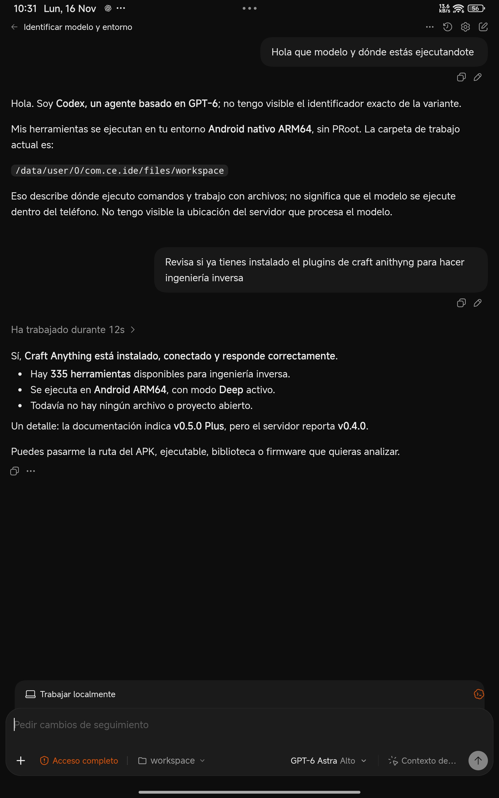
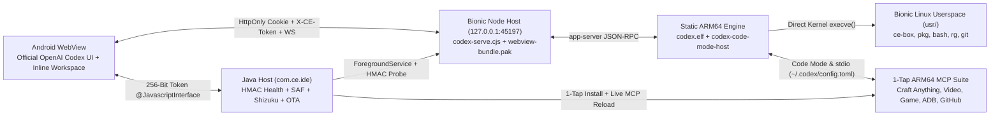
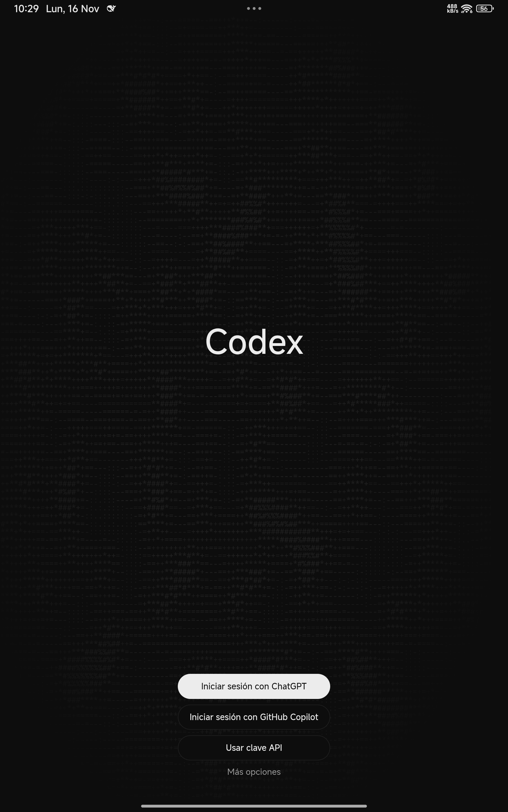
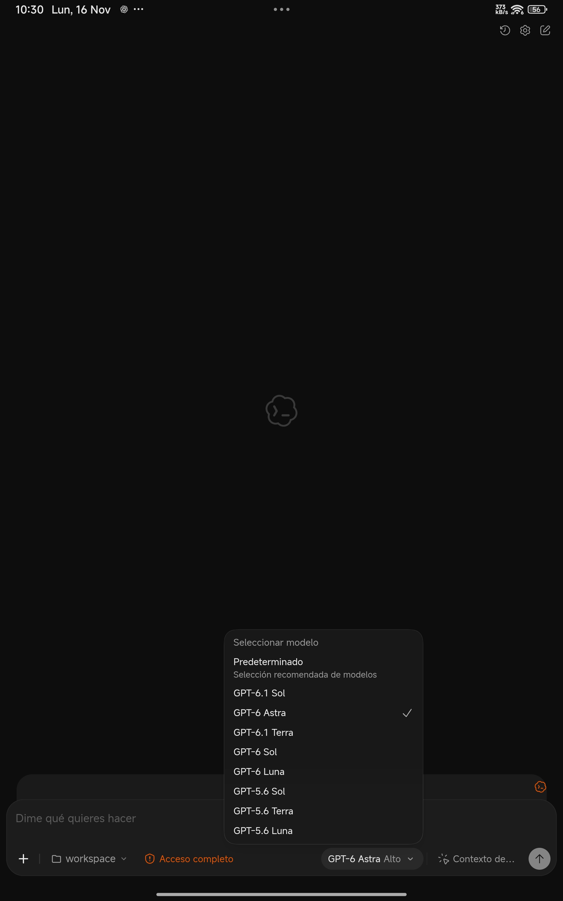
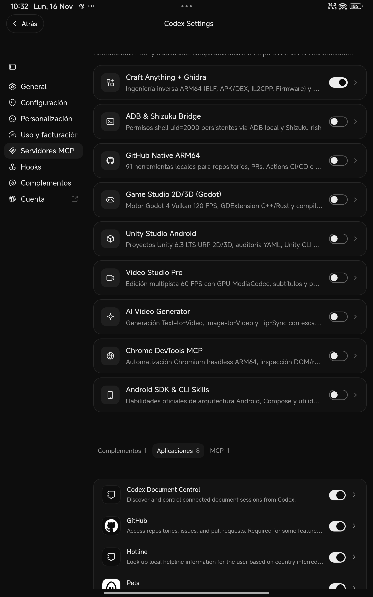

<div align="center">

  <br/>

  

  <h1 align="center">Codex for Android</h1>

  <p><font color="#7d8590">Standalone <b>OpenAI Codex (<code>v26.51111</code> + CLI <code>0.169.0</code>)</b> agentic IDE &amp; native <b>ARM64 Android</b> APK — created and engineered by <a href="https://github.com/Yhoanes"><b>Yhoanes</b></a> (zero PRoot, zero Electron, zero Termux dependency, zero Gradle).</font></p>

  <p>
    <code>v26.51111.1-r1</code> &nbsp;&bull;&nbsp;
    <code>Android 9.0+ (API 28+)</code> &nbsp;&bull;&nbsp;
    <code>Official Codex Extension UI</code> &nbsp;&bull;&nbsp;
    <code>Direct Kernel execve() ARM64</code> &nbsp;&bull;&nbsp;
    <code>Code Mode + Native MCP</code> &nbsp;&bull;&nbsp;
    <code>O(1) webview-bundle.pak</code> &nbsp;&bull;&nbsp;
    <code>Live GitHub OTA</code>
  </p>

  <br/>

  

</div>

<br/>

---

## Architectural Overview

**Codex for Android (`v26.51111.1-r1`)** brings OpenAI's official **Codex VS Code Extension UI** (`openai.chatgpt` `v26.51111.21308`) paired with the native static ARM64 **`codex` CLI (`0.169.0-alpha.11.1`)** and **`codex-code-mode-host`** directly to Android phones and tablets as a self-contained standalone APK (`com.ce.ide`).

Unlike slow `proot-distro` containers, emulated Linux VMs, or remote SSH wrappers, **Codex for Android** executes natively on mobile ARM64 silicon via direct Linux kernel `execve()`: pairing static `aarch64` `codex.elf` + `codex-code-mode-host` engines with a hardened Bionic `Node.js` Extension Host (`codex-serve.cjs` + `vscode-shim.cjs`), an **O(1) byte-indexed asset archive (`webview-bundle.pak`)**, a 10-byte prefix-aligned **Android Bionic Linux userspace** (`/data/user/0/com.ce.ide/files/usr`) powered by **`ce-box`**, an inline mobile workspace selector, and a **1-Tap Native ARM64 MCP Plugins &amp; Skills Marketplace**.

> [!IMPORTANT]
> **10-Byte Native Prefix Parity (`com.ce.ide` == `com.termux`):** By engineering an exact 10-character Android application ID (`com.ce.ide` for release, `com.ce.dev` for side-by-side dev builds), the embedded Linux userspace maintains binary path-length parity with standard Bionic packages — enabling direct native execution of `clang`, `rust`, `python`, `nodejs`, `git`, `ripgrep`, `ghidra`, and `openjdk-21` at physical UFS storage speeds with **zero `PRoot` overhead**.



---

## Core Engineering Pillars

| Subsystem | Technical Implementation |
| :--- | :--- |
| **100% Official OpenAI Codex UI** | Runs OpenAI's unmodified `v26.51111.21308` `extension.js` and official webview UI with ChatGPT OAuth, GitHub Copilot OAuth, API Key sign-in, full **GPT-6** (`GPT-6.1 Sol`, `GPT-6 Astra`, `GPT-6.1 Terra`, `GPT-6 Sol`, `GPT-6 Luna`) &amp; **GPT-5.6** model selection, reasoning effort levels, diff viewer, and multi-thread history. |
| **Native ARM64 `codex` + `codex-code-mode-host`** | Bundles both static `aarch64-unknown-linux-musl` binaries (`codex.elf` + `codex-code-mode-host`) so GPT-6 Code Mode (`exec` JS cells over `grpc+stdio://`) invokes native ARM64 MCP servers in `~30 ms` with zero container or socket sandbox conflicts. |
| **Instant O(1) Asset Serving (`webview-bundle.pak`)** | Packs all `15,350` webview modules into a single byte-indexed archive (`webview-bundle.pak`), eliminating 15k-inode extraction delays on mobile UFS storage and serving assets in `< 2 ms`. |
| **Inline Mobile Workspace Selector** | Native horizontal composer pill (`+  ! Full access | 📁 workspace ▾`) integrated into `[data-composer-leading-controls]` with visual-viewport keyboard tracking, instant folder creation, recent project switching, and Android SAF directory picking. |
| **Capability-Hardened Loopback Security** | Per-boot 256-bit `CE_AUTH_TOKEN` (`HttpOnly; SameSite=Strict` `ce_auth` cookie + `X-CE-Token` header), `HMAC-SHA256` nonce challenge on `/__ce_health`, strict loopback `Host`/`Origin` verification against DNS rebinding/CSRF, and explicit `403` confinement over `auth.json`, `.netrc`, and signing secrets. |
| **1-Tap ARM64 MCP Marketplace &amp; Live GitHub OTA** | Install, toggle, or uninstall compiled **Android ARM64 Rust MCP servers** directly inside **Codex Settings &rarr; MCP Servers** with instant live session hot-reload (`config/mcpServer/reload`), paired with SHA-256 certificate-pinned **GitHub Releases OTA updates**. |

---

## Visual Walkthrough

### 1. Official Codex Onboarding &amp; Inline Model / Workspace Controls
Sign in via **ChatGPT Subscription**, **GitHub Copilot**, or **API Key** on the clean official welcome screen, switch seamlessly across **GPT-6.1 / GPT-6 Astra / GPT-5.6** models, and pick or create local Android project folders directly from the inline composer bar:

<p align="center">
  
  
</p>

---

### 2. Live Native ARM64 Agent Execution &amp; 1-Tap `MCP Servers` Marketplace
Execute **GPT-6 Astra** sessions directly against local Android storage and install native ARM64 Rust MCP toolchains with a single tap from **Codex Settings &rarr; MCP Servers**:

<p align="center">
  
  
</p>

| Native ARM64 Plugin | Version | Capabilities on Android |
| :--- | :---: | :--- |
| **Craft Anything + Ghidra** | `v0.5.0` | **335 native Rust MCP tools** (`<50 MB` RAM) for ELF/PE/Mach-O, APK/DEX, `.NET`/NativeAOT, WASM, ESP32/UF2, Godot `.pck`, Unity IL2CPP &amp; GameCube/Wii `.dol` + on-demand native ARM64 **Ghidra 12.1.4** (`craft-ghidra-setup`). |
| **ADB &amp; Shizuku Bridge** | `v1.0.1` | Standalone native Rust wireless ADB 6-digit pairing (`127.0.0.1:5555` offline TCP mode — **no external PC required**), zero-polling mDNS discovery, and 2s MIUI-safe Shizuku `rish` fallback (`uid=2000`). |
| **GitHub Native ARM64** | `v2.1.1` | 91 native ARM64 GitHub tools (repositories, PRs, code reviews, Issues, Actions CI/CD logs, security alerts) + native Bionic Git/GH OAuth setup without Docker. |
| **Game Studio 2D/3D (Godot)** | `v2.0.0` | 16 native Rust MCP tools + ARM64 `GDExtension` (`C++`/`Rust`) compiler + 100% local offline signed `.apk` builder and 120–144 FPS Vulkan profiler for **Godot 4**. |
| **Unity Studio Android** | `v1.0.0` | 13 native Rust MCP tools + ported **Unity CLI `v1.0.0`** for Unity 6.3 LTS URP 2D/3D scaffolding, deterministic `.meta`/YAML auditing, `$0` GameCI builds, and live debugging. |
| **Video Studio Pro** | `v4.0.0` | Pro 60 FPS Motion Design &amp; universal video studio with `h264_mediacodec` GPU encoding, multi-track B-Roll, PiP/Split-Screen, Karaoke captions, and rootless CapCut Android timeline export. |
| **AI Video Generator** | `v1.0.0` | Native Rust AI video generation engine (Text-to-Video, Image-to-Video, First-Last Frame bridging, scene extension, and Lip-Sync) + GPU super-resolution. |
| **Chrome DevTools MCP** | `v1.10.4` | Headless native ARM64 Chromium automation via Chrome DevTools Protocol (DOM snapshots, network inspection, screenshots, and Core Web Vitals auditing). |
| **Android SDK &amp; CLI Skills** | `v1.0.0` | Official Android architecture, Jetpack Compose, Gradle/SDK workflows, and on-device `logcat`/`dumpsys` diagnostics. |

---

## System Requirements

| Component | Minimum | Recommended |
| :--- | :--- | :--- |
| **OS Version** | Android 9.0 Pie (`API 28`) | Android 12 – 16+ |
| **CPU Architecture** | `arm64-v8a` (`aarch64`) | Snapdragon 8 Gen 1+ / Tensor G2+ / Dimensity 9000+ |
| **Memory (RAM)** | `4 GB` | `8 GB – 16 GB` (especially when running Ghidra 12.1.4 or Chromium) |
| **Free Storage** | `1.2 GB` (APK + extracted ARM64 runtime) | `4 GB+` (for `clang`, `rust`, `python`, `openjdk-21`, and Ghidra) |
| **Root Access** | **Not Required** | Optional **ADB &amp; Shizuku Bridge** plugin from **Settings &rarr; MCP Servers** for `uid=2000(shell)` |

---

## Installation &amp; Automatic OTA Updates

1. Download the latest signed **`Codex-v*.apk`** from [**GitHub Releases**](https://github.com/Yhoanes/codex-android/releases/latest) and install it on your ARM64 Android device.
2. Launch **Codex**: on first boot, `CoreInstaller` verifies `manifest.json` SHA-256 digests and unpacks the native ARM64 runtime (`codex.elf`, `codex-code-mode-host`, `node.elf`, `webview-bundle.pak`, and `ce-box` Bionic userspace).
3. Sign in with your **ChatGPT account**, **GitHub Copilot**, or an **OpenAI API Key**.
4. **Automatic Releases OTA:** `AppUpdateManager` checks `Yhoanes/codex-android` Releases in the background (or manually via **Codex Settings &rarr; General &rarr; Check for updates**), cryptographically verifies the **RSA-4096 production signing certificate (`SHA-256`)**, and installs updates seamlessly via Shizuku (`pm install -r -d`) or Android's system `PackageInstaller`.

---

## Building from Source (Gradle-Free Deterministic Pipeline)

`codex-android` compiles in ~40 seconds directly on **Android ARM64** or **Linux** using its self-contained 11-phase shell + `javac`/`d8`/`aapt`/`apksigner` pipeline (no Gradle daemon required). Large binary archives (`codex-core.tar.gz` and `webview-bundle.pak`) are stored in `< 80 MB` repository chunks (`.part-*`) and automatically reassembled + SHA-256 verified on the first build:

```bash
git clone https://github.com/Yhoanes/codex-android.git
cd codex-android
chmod +x build.sh

# Build Release APK (com.ce.ide, port 45197):
./build.sh

# Build Side-by-Side Dev APK (com.ce.dev, port 45198):
./build.sh --dev
```

---

## License &amp; Mandatory Attribution

Copyright &copy; 2026 **[Yhoanes](https://github.com/Yhoanes)**.

This repository and its compiled APK distributions are released under the **Open-Source Non-Commercial &amp; Mandatory Attribution License (`BY-NC` + Apache License 2.0 Base)** — see [LICENSE](LICENSE) and [NOTICE](NOTICE) for full legal terms:

- **Non-Commercial Use Only:** Selling, commercializing, monetizing, paywalling, or bundling this software, modified versions, or its APK binaries for any commercial purpose is **strictly prohibited** without prior written permission from **Yhoanes**.
- **Mandatory Attribution:** Any fork, redistribution, modified version, or derivative build **must** prominently credit **[Yhoanes](https://github.com/Yhoanes)** as the original author and include a direct link to [`https://github.com/Yhoanes/codex-android`](https://github.com/Yhoanes/codex-android).
